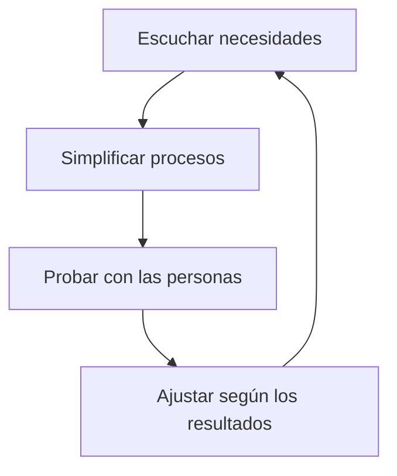

# Servicio Local de Educación Pública de Chacabuco

El SLEP Chacabuco provee educación pública a través de los establecimientos educacionales de su dependencia en **Colina, Lampa y Tiltil**, en la Región Metropolitana.

## Tecnología al servicio de las personas

Nuestra visión es que los sistemas digitales faciliten el trabajo diario de los equipos del Servicio Local y de los establecimientos, y que los procesos sean más claros para las comunidades educativas. Partimos de las necesidades de quienes usan los sistemas, simplificamos los pasos, probamos las soluciones con las personas y usamos sus comentarios para seguir mejorando.

## Investigación y aprendizaje

Nos interesa explorar cómo los modelos de lenguaje y otras tecnologías pueden apoyar tareas como la búsqueda de información y la elaboración de borradores. Queremos evaluar su utilidad, sus errores y sus límites con resguardo de los datos y revisión humana de los resultados.

## Desarrollo en GitHub

Este espacio está destinado a compartir y documentar herramientas y proyectos digitales de publicación pública. El repositorio [`.github`](https://github.com/SLEP-Chacabuco/.github) contiene el archivo que se muestra en este perfil.

## Enlaces institucionales

- [Sitio web del SLEP Chacabuco](https://slepchacabuco.gob.cl/)
- [Dirección de Educación Pública](https://dep.gob.cl/)
- [Ley N.º 21.040, que crea el Sistema de Educación Pública](https://www.bcn.cl/leychile/navegar?idLey=21040)
